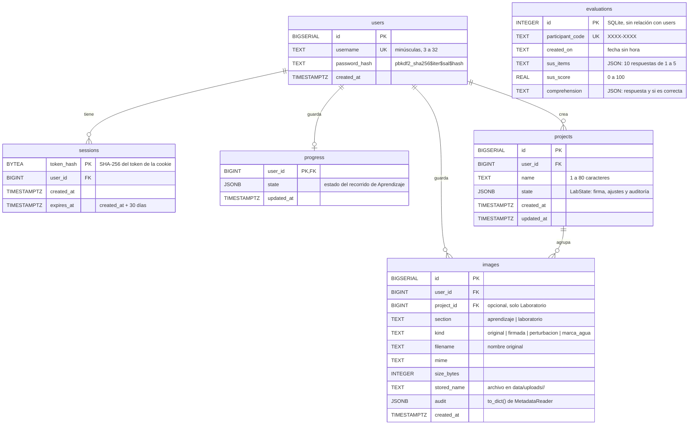

# Escudo Visual

Proyecto de grado que audita los metadatos de una imagen (EXIF, XMP, IPTC, texto PNG y C2PA) para estimar qué tan expuesta está al *scraping* y al entrenamiento de modelos de IA, y guía al usuario paso a paso para protegerla.

La aplicación organiza la protección en cuatro capas:

1. **Autoría en los metadatos**: autor y copyright en EXIF/XMP/IPTC.
2. **Señales de exclusión de IA**: etiquetas `noai`, `noimageai`, IPTC `DataMining` y TDMRep `tdm:reservation`.
3. **Perturbación visual**: un "cloak" tipo Glaze sobre el VAE de Stable Diffusion, comparado con una marca de agua visible.
4. **Dónde y cómo publicas**: el Asistente de Publicación Segura genera recomendaciones a partir de la auditoría del archivo.

El flujo empieza con un mapa de capas y termina con un resumen del estado de cada una.

La cabecera alterna tres secciones: **Aprendizaje** (el recorrido guiado), **Laboratorio** (las mismas herramientas sin pasos, con su propio estado) y **Proyectos** (trabajos del Laboratorio guardados con nombre). Las cuentas son opcionales: sin sesión la aplicación funciona igual y no guarda nada; con sesión se puede guardar el progreso del recorrido, proyectos del Laboratorio y las imágenes que la persona elija.

---

## Tabla de contenido

- [Arquitectura](#arquitectura)
- [Requisitos](#requisitos)
- [Instalación y ejecución](#instalación-y-ejecución)
- [API](#api)
- [Cuentas opcionales](#cuentas-opcionales)
- [Cálculo del puntaje de riesgo](#cálculo-del-puntaje-de-riesgo)
- [Corpus de validación](#corpus-de-validación)
- [Evaluación de usabilidad y comprensión](#evaluación-de-usabilidad-y-comprensión)
- [Pruebas](#pruebas)
- [Frontend](#frontend)
- [Privacidad](#privacidad)
- [Limitaciones conocidas](#limitaciones-conocidas)
- [Solución de problemas](#solución-de-problemas)

---

## Arquitectura

Monorepo con dos aplicaciones independientes:

```
Proyecto_grado/
├── backend/                  # API en FastAPI (Python 3.9)
│   ├── main.py               # Endpoints, validación y manejo de archivos temporales
│   ├── requirements.txt
│   └── core/
│       ├── metadata_reader.py   # Lectura de metadatos, categorías, puntaje y C2PA
│       ├── metadata_writer.py   # Escritura de autoría y etiquetas de exclusión
│       ├── publication_advisor.py  # Asistente de Publicación Segura (evalúa publication_rules.json)
│       ├── publication_rules.json  # Reglas de recomendación, editables sin tocar código
│       ├── evaluations.py       # Evaluaciones SUS y de comprensión en SQLite
│       ├── db.py                # Conexión a PostgreSQL y esquema (cuentas opcionales)
│       ├── accounts.py          # Usuarios, sesiones, progreso, proyectos e imágenes guardadas
│       ├── sus.py               # Puntuación SUS (Brooke, 1996)
│       ├── image_protector.py   # Cloak adversarial (PGD sobre el VAE) y marca de agua
│       ├── image_stressor.py    # Redimensionado y recompresión JPEG
│       ├── resistance_suite.py  # Suite de resistencia: qué protecciones sobreviven a cada transformación
│       └── watermark.py         # Dibujo y máscara de la marca visible (sin PyTorch)
├── backend/scripts/          # Corpus de validación (build_corpus, run_validation) y firmante C2PA de prueba
├── backend/results/          # CSV de resultados (solo se versionan los example_*.csv)
├── backend/tests/            # Pruebas pytest (python -m pytest -q)
└── frontend/                 # React 19 + Vite + Tailwind 4 (JS/JSX)
    ├── vite.config.js        # Proxy de /api hacia el backend
    └── src/
        ├── App.jsx           # Estado global y navegación entre pasos
        ├── data/layers.js    # Fuente única de verdad: pasos, textos y estados
        ├── data/literacy.js  # Textos del Módulo 1 (conceptos clave)
        ├── data/evaluation.js, data/comprehension.json  # Consentimiento, SUS y cuestionario
        ├── lib/motion.js     # Utilidades de animación
        ├── lib/account.js    # Contextos de cuenta y sección, y llamadas a la API de cuentas
        ├── lib/useLabProject.js  # Estado del Laboratorio y autoguardado del proyecto abierto
        └── components/       # Componentes y vistas de cada paso (steps/)
```

| Capa | Tecnologías |
|------|-------------|
| Backend | FastAPI, Uvicorn, Pillow, piexif, c2pa-python 0.8, NumPy, SQLite (estándar), PostgreSQL con psycopg 3 (cuentas opcionales), pytest; PyTorch y diffusers solo con `ENABLE_LIVE_CLOAK=1` o para regenerar ejemplos; cryptography para la firma C2PA de prueba |
| Frontend | React 19, Vite, Tailwind CSS 4, motion, Phosphor Icons, Geist, oxlint |

---

## Requisitos

- Python 3.9 (el entorno virtual del proyecto usa 3.9.6).
- Node.js 20 o superior y npm.
- Opcional, solo para las cuentas: PostgreSQL (por ejemplo `brew install postgresql@18`).
- Solo con `ENABLE_LIVE_CLOAK=1` o para regenerar los ejemplos: conexión a internet la primera vez, porque el modelo `stabilityai/sd-vae-ft-mse` se descarga a la caché de Hugging Face.
- Recomendado: Mac con Apple Silicon (el modelo usa MPS si está disponible) o una máquina con suficiente RAM para PyTorch.

---

## Instalación y ejecución

Los dos servidores deben estar corriendo al mismo tiempo.

### Backend

```bash
cd backend
python3 -m venv .venv          # solo si no existe
source .venv/bin/activate
pip install -r requirements.txt
uvicorn main:app --reload --port 8000
```

El puerto debe ser **8000**, porque el proxy de Vite apunta ahí. Para verificar que funciona:

```bash
curl http://127.0.0.1:8000/api/health
```

#### Cuentas (opcional)

Sin PostgreSQL los endpoints de cuentas responden `503` y el resto de la aplicación funciona igual. Para activarlas:

```bash
createdb escudo_visual          # base de la aplicación
createdb escudo_visual_test     # base de las pruebas de cuentas
```

El esquema se crea en la primera conexión.

| Variable | Por defecto | Uso |
|----------|-------------|-----|
| `DATABASE_URL` | `postgresql:///escudo_visual` | Base de datos de las cuentas |
| `TEST_DATABASE_URL` | `postgresql:///escudo_visual_test` | Base de `tests/test_accounts.py` (se omite si no responde) |
| `COOKIE_SECURE` | sin definir | `1` cuando se sirve por HTTPS, para marcar la cookie como `Secure` |
| `ENABLE_LIVE_CLOAK` | sin definir | `1` activa `/api/protect` |
| `EVAL_EXPORT_TOKEN` | sin definir | Activa `/api/evaluations/export` |

### Frontend

```bash
cd frontend
npm install
npm run dev        # http://localhost:5173
```

Otros comandos:

| Comando | Descripción |
|---------|-------------|
| `npm run build` | Genera la versión de producción en `dist/` |
| `npm run preview` | Sirve la versión de producción localmente |
| `npm run lint` | Ejecuta oxlint (configuración en `.oxlintrc.json`) |

---

## API

Todos los endpoints que reciben imágenes esperan `multipart/form-data` con el archivo en el campo `file`.

- Extensiones permitidas: `.jpg`, `.jpeg`, `.png`, `.webp`, `.tif`, `.tiff`.
- Tamaño máximo: 25 MB.
- Los mensajes de error se devuelven en español en el campo `detail`. Los errores de validación de FastAPI llegan como una lista en `detail`, no como texto.
- CORS solo permite los orígenes de `localhost:5173`.

### `GET /api/health`

Comprueba que el backend esté activo. Devuelve `{"status": "ok", "live_cloak": false}`; `live_cloak` indica si `/api/protect` está activado.

### `POST /api/audit`

Analiza los metadatos de la imagen y devuelve el diagnóstico.

```bash
curl -F "file=@foto.jpg" http://127.0.0.1:8000/api/audit
```

La respuesta incluye los hallazgos por fuente (EXIF, XMP, IPTC, texto PNG) con su categoría (`author`, `copyright`, `exclusion`, `privacy`, `info`), las banderas `has_*`, las etiquetas de exclusión encontradas, el puntaje, el nivel de riesgo y la información C2PA (`present`, `valid`, `issuer`, `generator`, `ai_generated`, `errors`).

### `POST /api/write-metadata`

Firma la imagen con información de autoría sin modificar los píxeles.

| Campo | Tipo | Descripción |
|-------|------|-------------|
| `author` | texto, obligatorio | Nombre del autor |
| `copyright` | texto, opcional | Por defecto `© <año> <autor>` |
| `ai_opt_out` | booleano | Agrega `noai`/`noimageai`, IPTC `plus:DataMining` (`DMI-PROHIBITED-AIMLTRAINING`) y TDMRep `tdm:reservation` |
| `strip_gps` | booleano | Elimina la ubicación GPS |

Escribe EXIF `Artist`/`Copyright` y reemplaza el paquete XMP (`dc:creator`, `dc:rights`, `xmpRights`). En JPEG solo reescribe los segmentos APP1, sin recomprimir. PNG y TIFF son sin pérdida y WebP se guarda con `lossless=True`, así que un cloak aplicado antes se conserva. Devuelve `{filename, image, audit}`: la imagen como data URL y la auditoría del archivo ya firmado.

### `POST /api/stress-test`

Simula el tratamiento que hacen las plataformas al subir una imagen: redimensionado Lanczos y recompresión JPEG sin metadatos. Devuelve `image/jpeg`.

| Campo | Rango |
|-------|-------|
| `quality` | 1 a 95 |
| `scale` | 0.1 a 1.0 |
| `passes` | 1 a 5 |

### `POST /api/stress-suite`

Aplica a la imagen las transformaciones habituales de la web y registra, para cada una, si sobreviven los metadatos (EXIF, XMP, IPTC), las credenciales C2PA, las señales noai y la marca defensiva.

```bash
curl -F "file=@foto.jpg" -F "watermark_text=© Autor" http://127.0.0.1:8000/api/stress-suite
```

| Campo | Por defecto | Rango |
|-------|-------------|-------|
| `jpeg_qualities` | `50,75` | 1 a 3 valores entre 1 y 95, separados por comas |
| `resample_side` | `1080` | 64 a 8192 px (lado mayor) |
| `crop_pct` | `5` | 1 a 40 % de cada borde |
| `screen_width`, `screen_height` | `1920`, `1080` | 320 a 3840, 240 a 2160 |
| `watermark_text` | vacío | hasta 40 caracteres; vacío = no se mide la marca |
| `watermark_opacity` | `35` | 5 a 90 |

Transformaciones: compresión JPEG (una fila por calidad), remuestreo al lado mayor, recorte de bordes, cambio de formato a PNG, JPEG (calidad 90) y WebP (con pérdida, calidad 80), y reducción a la resolución de pantalla seguida de una captura simulada (PNG sin metadatos). La captura es una aproximación: no reproduce el escalado del sistema operativo, la gestión de color ni la interfaz alrededor. Las transformaciones que no son de compresión se guardan en el formato original (TIFF pasa a PNG) con calidad 95.

Las transformaciones conservan lo que Pillow puede copiar (EXIF, XMP y perfil ICC): miden el mejor caso. Pillow no escribe IPTC-IIM ni manifiestos C2PA, así que esos no sobreviven a ninguna recodificación.

Cada fila trae `metadata`, `c2pa`, `noai` y `watermark`, cada uno con `status` igual a `sobrevive`, `no sobrevive` o `no aplica` (el original no tenía esa protección). `baseline` describe el original y `watermark_threshold` el umbral usado.

#### Detección de la marca defensiva

La suite dibuja la marca de `core/watermark.py` sobre una copia de los píxeles, aplica la misma transformación a la copia marcada, a una copia sin marca (control negativo) y a la máscara de la marca, y calcula la correlación de Pearson entre el detalle fino (paso alto, desenfoque gaussiano de radio 4) de la luminancia y el de la máscara. La máscara es la marca a opacidad completa sobre gris medio, así el relleno claro y el contorno oscuro cuentan con su signo, sea cual sea el fondo.

La marca cuenta como detectable si la correlación es **0,10 o más** (`WATERMARK_THRESHOLD`). Calibración con cinco imágenes sintéticas de 2400×1600 (ruido blanco, degradado, formas, texto y negro) en las ocho transformaciones:

| | Mínimo marcado (35 %) | Mínimo marcado (10 %) | Máximo del control sin marca |
|-|-----------------------|-----------------------|------------------------------|
| Correlación | 0,17 (ruido blanco) | 0,05 (ruido blanco) | 0,003 |

El umbral queda unas 40 veces por encima del control y por debajo del peor caso con la opacidad por defecto. Con opacidades muy bajas sobre imágenes con mucho detalle, la marca puede salir como no detectable aunque se intuya a simple vista. El umbral se recalibrará con el corpus de validación.

### `POST /api/protect`

**Desactivado por defecto.** La tesis establece que las comparaciones del Módulo 1 usan ejemplos precalculados, sin ejecutar redes neuronales en tiempo real. Sin `ENABLE_LIVE_CLOAK=1` responde `503` y el backend ni siquiera carga PyTorch. Para activarlo:

```bash
ENABLE_LIVE_CLOAK=1 uvicorn main:app --reload --port 8000
```

Genera el cloak adversarial y una marca de agua visible, y los compara con las mismas métricas. Tarda entre 25 y 60 segundos.

| Campo | Valores |
|-------|---------|
| `strength` | `baja`, `media`, `alta` (épsilon L-inf 4, 8 o 16 sobre 255) |
| `watermark_text` | texto de la marca de agua |
| `watermark_opacity` | 5 a 90 |

Funcionamiento del cloak:

- Ataque PGD de 30 pasos sobre el codificador del VAE `stabilityai/sd-vae-ft-mse`, que empuja la representación latente hacia un patrón fijo.
- Se calcula a 512 px y se escala sobre la imagen original (máximo 2048 px).
- Se mide el SSIM "para una persona" (imagen protegida contra original) y "para el modelo" (reconstrucción del VAE de la protegida contra la de la original), también después de una compresión JPEG 75.
- Un candado a nivel de módulo serializa el uso del modelo, por lo que las peticiones se atienden de una en una.

Las imágenes se devuelven como data URLs (PNG para las descargas).

---

### `POST /api/publication-advice`

Audita la imagen y devuelve las recomendaciones del Asistente de Publicación Segura, ordenadas de más a menos importantes.

```json
{"filename": "foto.jpg", "format": "JPEG", "jpeg_quality": 95, "lossy": true,
 "recommendations": [{"id": "sin_autor", "severity": "alta", "title": "...", "detail": "...",
                      "action": {"label": "Firmar en la capa 1", "step": "metadatos"}}]}
```

Las reglas están en `backend/core/publication_rules.json`. Cada una tiene `id`, `severity` (`alta`, `media`, `info`), `when` (`"always"` o una lista de condiciones `{field, op, value}` que deben cumplirse todas), `title`, `detail` y, opcionalmente, `action` con el paso del frontend al que lleva. `field` es una ruta sobre el reporte de `/api/audit` más `jpeg_quality` (estimada) y `lossy`. Operadores: `eq`, `ne`, `gte`, `lte`, `in`, `empty`, `not_empty`.

| Regla | Cuándo aplica |
|-------|---------------|
| `sin_autor`, `sin_copyright` | No hay autoría o copyright: sugiere firmar con `write-metadata` |
| `sin_noai` | No hay etiquetas de exclusión: ofrece la exclusión de IA |
| `gps` | Hay datos GPS: sugiere `strip_gps` |
| `sin_c2pa` / `c2pa_invalida` | No hay C2PA (la procedencia no puede verificarse) o la firma no es válida |
| `perdida_alta` | JPEG con calidad estimada de 90 o más: sugiere guardar una copia sin pérdida para editar |
| `terminos`, `reauditar` | Siempre: leer los términos de la plataforma y auditar la versión publicada |

En el frontend, el archivo vigente (el subido en la capa 1 o su última versión firmada) se analiza cada vez que cambia. La capa 4 está lista cuando la persona marca todas las recomendaciones.

## Cuentas opcionales

Usuario y contraseña, sin correo. Las contraseñas se derivan con PBKDF2-SHA256 (600 000 iteraciones, biblioteca estándar; `hashlib.scrypt` no existe en el Python 3.9 de macOS). La sesión viaja en la cookie `ev_session` (`httpOnly`, `SameSite=Lax`, 30 días) y en la base solo se guarda el SHA-256 del token. Todas las consultas filtran por `user_id`, así que una cuenta nunca ve los datos de otra.

| Endpoint | Descripción |
|----------|-------------|
| `POST /api/auth/register` | `{username, password}`: usuario de 3 a 32 caracteres (`A-Z a-z 0-9 _ . -`, se guarda en minúsculas), contraseña de 8 a 128. `409` si el usuario ya existe. Inicia sesión |
| `POST /api/auth/login` | Mismo cuerpo. `401` si las credenciales no coinciden |
| `POST /api/auth/logout` | Cierra la sesión y borra la cookie |
| `GET /api/auth/me` | Usuario de la sesión actual, `401` sin sesión |
| `DELETE /api/auth/me` | Borra la cuenta, sus sesiones, su progreso, sus imágenes y su carpeta de archivos |
| `GET /api/progress`, `PUT /api/progress` | Estado del recorrido de Aprendizaje (paso, casillas, datos de firma, ajustes de perturbación y de estrés, auditoría). Rechaza campos desconocidos y más de 256 KB |
| `GET /api/projects` | Proyectos del Laboratorio, el último modificado primero, con autor, nivel de riesgo, número de imágenes y portada |
| `POST /api/projects` | `{name, state?}`: nombre de 1 a 80 caracteres. `state` (`LabState`) guarda firma, ajustes de perturbación y de estrés y auditoría; rechaza campos desconocidos y más de 256 KB |
| `GET /api/projects/{id}` | Proyecto con su estado y sus imágenes |
| `PATCH /api/projects/{id}` | `{name?, state?}`: renombra, actualiza el estado o ambos |
| `DELETE /api/projects/{id}` | Borra el proyecto, sus imágenes y los archivos de estas |
| `GET /api/images?section=` | Imágenes guardadas, filtrables por `aprendizaje` o `laboratorio` |
| `POST /api/images` | `file`, `section` (`aprendizaje`, `laboratorio`), `kind` (`original`, `firmada`, `perturbacion`, `marca_agua`) y, opcional, `project_id`. Guarda el archivo con su auditoría. `404` si el proyecto no es de la cuenta |
| `GET /api/images/{id}/file` | Descarga una imagen guardada |
| `DELETE /api/images/{id}` | Borra una imagen guardada |

Los archivos van a `backend/data/uploads/<user_id>/` (no versionado) y en PostgreSQL quedan su ruta y su auditoría. Si la base no responde, cualquier `psycopg.OperationalError` se convierte en un `503` con un mensaje en español.

### Modelo de datos

Hay dos bases independientes y sin relación entre sí: PostgreSQL para las cuentas (`core/db.py`, cinco tablas) y SQLite para las evaluaciones anónimas (`core/evaluations.py`, una tabla). Las evaluaciones no tienen clave hacia `users` a propósito, para que sigan siendo anónimas.



| Tabla | Columna | Tipo | Restricciones |
|-------|---------|------|---------------|
| `users` | `id` | `BIGSERIAL` | PK |
| | `username` | `TEXT` | `NOT NULL`, `UNIQUE` |
| | `password_hash` | `TEXT` | `NOT NULL` |
| | `created_at` | `TIMESTAMPTZ` | `NOT NULL`, `DEFAULT now()` |
| `sessions` | `token_hash` | `BYTEA` | PK |
| | `user_id` | `BIGINT` | `NOT NULL`, FK `users(id)` `ON DELETE CASCADE` |
| | `created_at` | `TIMESTAMPTZ` | `NOT NULL`, `DEFAULT now()` |
| | `expires_at` | `TIMESTAMPTZ` | `NOT NULL` |
| `progress` | `user_id` | `BIGINT` | PK y FK `users(id)` `ON DELETE CASCADE` (relación 1 a 0..1) |
| | `state` | `JSONB` | `NOT NULL` |
| | `updated_at` | `TIMESTAMPTZ` | `NOT NULL`, `DEFAULT now()` |
| `projects` | `id` | `BIGSERIAL` | PK |
| | `user_id` | `BIGINT` | `NOT NULL`, FK `users(id)` `ON DELETE CASCADE` |
| | `name` | `TEXT` | `NOT NULL` |
| | `state` | `JSONB` | `NOT NULL` |
| | `created_at` | `TIMESTAMPTZ` | `NOT NULL`, `DEFAULT now()` |
| | `updated_at` | `TIMESTAMPTZ` | `NOT NULL`, `DEFAULT now()` |
| `images` | `id` | `BIGSERIAL` | PK |
| | `user_id` | `BIGINT` | `NOT NULL`, FK `users(id)` `ON DELETE CASCADE` |
| | `project_id` | `BIGINT` | FK `projects(id)` `ON DELETE CASCADE`, nulo si la imagen no pertenece a un proyecto |
| | `section` | `TEXT` | `NOT NULL`, `CHECK IN ('aprendizaje', 'laboratorio')` |
| | `kind` | `TEXT` | `NOT NULL`, `CHECK IN ('original', 'firmada', 'perturbacion', 'marca_agua')` |
| | `filename` | `TEXT` | `NOT NULL` |
| | `mime` | `TEXT` | `NOT NULL` |
| | `size_bytes` | `INTEGER` | `NOT NULL` |
| | `stored_name` | `TEXT` | `NOT NULL` |
| | `audit` | `JSONB` | `NOT NULL` |
| | `created_at` | `TIMESTAMPTZ` | `NOT NULL`, `DEFAULT now()` |
| `evaluations` (SQLite) | `id` | `INTEGER` | PK `AUTOINCREMENT` |
| | `participant_code` | `TEXT` | `NOT NULL`, `UNIQUE` |
| | `created_on` | `TEXT` | `NOT NULL` |
| | `sus_items` | `TEXT` | `NOT NULL` |
| | `sus_score` | `REAL` | `NOT NULL` |
| | `comprehension` | `TEXT` | `NOT NULL` |

Índices adicionales: `images_user_idx` sobre `images (user_id, created_at DESC)`, `projects_user_idx` sobre `projects (user_id, updated_at DESC)` e `images_project_idx` sobre `images (project_id)`. Todas las FK usan `ON DELETE CASCADE`, así que borrar un usuario borra sus sesiones, su progreso, sus proyectos y sus imágenes, y borrar un proyecto borra sus imágenes; `accounts.delete_user` y `accounts.delete_project` borran además los archivos. La columna `project_id` se añade con `ALTER TABLE ... ADD COLUMN IF NOT EXISTS`, así que las bases creadas antes de los proyectos se actualizan solas.

En el frontend, `AccountMenu` (un `<dialog>` nativo) gestiona registro, inicio y cierre de sesión y borrado de la cuenta. Con sesión, `App.jsx` restaura el progreso al iniciar sesión y lo guarda con un retardo de 1 s. `SaveImageButton` solo aparece con sesión: junto a la imagen subida (capa 1 y Laboratorio), junto a la imagen firmada en `MetadataSigner` y en las tarjetas de `ProtectionLab` con resultados reales (no en el ejemplo precalculado). `MyImages` muestra la galería en el Laboratorio. Los proyectos se describen en [Frontend](#frontend).

---

## Cálculo del puntaje de riesgo

El puntaje mide la **exposición**: un valor más alto significa una imagen **más vulnerable**. Parte de 100 y resta penalizaciones por cada protección encontrada:

| Protección encontrada | Resta |
|-----------------------|-------|
| Información de autoría | 25 |
| Aviso de copyright | 25 |
| Etiquetas de exclusión de IA | 40 |
| Derechos declarados también en XMP/IPTC | 10 |

| Puntaje | Nivel de riesgo |
|---------|-----------------|
| 70 o más | `alto` |
| 35 a 69 | `medio` |
| Menos de 35 | `bajo` |

Las etiquetas de exclusión se detectan con `EXCLUSION_PATTERN` (`noai`, `noimageai`, `do not train`, `tdm:reservation`, `dataminingprohibited`, `dmi-prohibited*`), tanto en los hallazgos como en el XMP sin procesar. La información C2PA se reporta pero no afecta el puntaje.

---

## Corpus de validación

El motor de auditoría y la suite de resistencia se validan sobre un corpus de cuatro grupos. Usa solo imágenes propias o con licencia libre. El corpus, los resultados y los certificados no se versionan.

```bash
cd backend
source .venv/bin/activate
python -m scripts.build_corpus ruta/a/mis_imagenes --out corpus --author "Nombre"
python -m scripts.run_validation --corpus corpus --out results
```

`build_corpus` normaliza cada imagen a JPEG (calidad 95, sin metadatos), porque IPTC-IIM solo se lee de forma fiable en JPEG, y genera:

| Grupo | Contenido |
|-------|-----------|
| `01_sin_metadatos` | Píxeles limpios, sin metadatos |
| `02_metadatos` | Autoría y copyright en EXIF y XMP (`metadata_writer`) y en IPTC (segmento APP13) |
| `03_noai` | Lo mismo con `ai_opt_out=True` |
| `04_c2pa` | Píxeles limpios con un manifiesto C2PA firmado con un certificado de prueba |

Los archivos se llaman `img001.jpg`, `img002.jpg`, ...; `corpus/sources.csv` relaciona cada id con el original. El certificado de prueba se genera solo la primera vez en `scripts/certs/`; ese README explica cómo crearlo con `openssl` y por qué `valid` no implica que el firmante sea de confianza.

`run_validation` escribe `results/audit_corpus.csv` (una fila por imagen, con `matches_expected` según lo que se escribió en su grupo) y `results/stress_results.csv` (una fila por imagen y transformación, con los cuatro indicadores). Termina con código 1 si alguna auditoría no coincide con lo esperado e imprime el rango de correlaciones de la marca para revisar el umbral.

`results/example_audit_corpus.csv` y `results/example_stress_results.csv` son un ejemplo con tres ilustraciones sintéticas generadas por el proyecto (12/12 auditorías coinciden; correlación mínima de la marca 0,81 y control máximo 0,004).

---

## Evaluación de usabilidad y comprensión

La interfaz incluye una evaluación anónima, accesible desde el resumen y desde el pie de página: consentimiento informado, la escala SUS (10 ítems de 1 a 5), un cuestionario de comprensión y una pantalla de agradecimiento.

- **Escala SUS**: `frontend/src/data/evaluation.js`. Se usa la versión en español validada por Sevilla-Gonzalez et al. (2020), *JMIR Human Factors* 7(4):e21161, [doi:10.2196/21161](https://doi.org/10.2196/21161), CC BY 4.0. **Pendiente**: el archivo trae un borrador con `verified: false` y la interfaz muestra un aviso hasta que se copie la redacción literal del Apéndice 2 del artículo y se cambie a `true`.
- **Comprensión**: `frontend/src/data/comprehension.json`. Cada pregunta tiene `id`, `question`, `options` y `correct`. Se puede editar sin tocar código.
- **Puntuación SUS** (`backend/core/sus.py`, Brooke, 1996): los ítems impares aportan `respuesta − 1` y los pares `5 − respuesta`; la suma se multiplica por 2,5 (de 0 a 100).
- **Anonimato**: el código de participante (`XXXX-XXXX`) se genera en el navegador con `crypto.getRandomValues`. El backend guarda en `backend/data/evaluations.sqlite` solo el código, la fecha sin hora, las respuestas SUS, su puntuación y las respuestas de comprensión (opción elegida y si es correcta). Rechaza cualquier otro campo. No guarda imágenes, nombres, IP ni navegador. La carpeta `backend/data/` no se versiona.

### `POST /api/evaluations`

```json
{"participant_code": "K7QX-M2PA", "sus": [4, 2, 4, 2, 4, 2, 4, 2, 4, 2],
 "comprehension": {"noai": {"answer": "b", "correct": true}}}
```

Responde `201` con `{participant_code, sus_score}`, `409` si el código ya envió una evaluación y `422` si algún campo no es válido.

### `GET /api/evaluations/export`

Devuelve un CSV con una fila por participante y una fila final de medias. Está desactivado salvo que se defina `EVAL_EXPORT_TOKEN`, y exige ese valor en la cabecera `Authorization`; si no, responde `403`.

```bash
EVAL_EXPORT_TOKEN=un-token-largo uvicorn main:app --port 8000
curl -H "Authorization: Bearer un-token-largo" http://127.0.0.1:8000/api/evaluations/export -o evaluaciones.csv
```

### Evaluación de conocimientos (diagnóstico y evaluación final)

Mide el aprendizaje antes y después del recorrido con los instrumentos ADDIE de `docs/addie/instrumentos/` (pendientes de validación académica; la interfaz lo avisa mientras tengan `"validated": false`). El diagnóstico se ofrece en el paso Mapa y la evaluación final en el Resumen; ambos son opcionales y anónimos. El código de participante se guarda solo en `sessionStorage`, así que une diagnóstico, evaluación final y SUS mientras la pestaña siga abierta.

- `GET /api/knowledge/{diagnostico|final}`: preguntas, escala de autoeficacia y perfil opcional, **sin** respuestas correctas.
- `POST /api/knowledge/{diagnostico|final}`: `{"participant_code", "answers": {id: opción}, "self_efficacy": {id: 1-5}, "profile": {...}}`. El servidor valida y corrige; responde `201` con aciertos, puntaje y resultado por objetivo. La final añade la explicación de cada pregunta y, si existe diagnóstico con el mismo código, `comparison` con la ganancia normalizada de Hake. `409` si el código ya respondió esa fase y `422` si falta o sobra algo.
- `GET /api/knowledge/export`: CSV con una fila por prueba (acierto por ítem, autoeficacia, perfil y ganancia). Mismo token que la exportación de evaluaciones.

Se guarda en la tabla `knowledge_tests` de `backend/data/evaluations.sqlite`: código, fase, versión del instrumento, fecha sin hora, respuestas, autoeficacia y perfil. Nunca nombres, IP, navegador ni imágenes.

---

## Pruebas

Las pruebas del backend usan pytest y corren sin conexión, sin PyTorch y sin escribir fuera de carpetas temporales. `test_accounts.py` usa la base `escudo_visual_test` y se omite si no está disponible:

```bash
cd backend
source .venv/bin/activate
python -m pytest -q
```

| Archivo | Qué cubre |
|---------|-----------|
| `test_score.py` | Penalizaciones, umbrales de riesgo y auditoría de un archivo firmado con C2PA |
| `test_sus.py` | Puntuación SUS con casos conocidos (50, 100, 0, 75, 87,5) y respuestas inválidas |
| `test_resistance_suite.py` | Cada transformación, los cuatro indicadores, detección de la marca y control negativo |
| `test_stress_suite_endpoint.py` | `/api/stress-suite` y sus parámetros |
| `test_corpus_scripts.py` | IPTC del corpus, `build_corpus` y `run_validation` de punta a punta |
| `test_evaluations.py` | `/api/evaluations` (solo datos anónimos, duplicados) y la exportación con token |
| `test_knowledge.py` | Diagnóstico y evaluación final: preguntas sin claves, corrección en servidor, comparación y ganancia, validación, duplicados, datos guardados y exportación |
| `test_live_cloak.py` | `/api/protect` desactivado por defecto y arranque sin PyTorch |
| `test_publication_advice.py` | Cada regla del asistente, estimación de calidad JPEG y el endpoint |
| `test_endpoints_validation.py` | 415, 413 y 422 en todos los endpoints con imagen, y contrato de `/api/audit` |
| `test_tempfiles.py` | Ningún temporal queda en disco tras éxito, imagen inválida o error inesperado |
| `test_accounts.py` | Registro, inicio y cierre de sesión, sesiones vencidas, contraseña no guardada en claro, progreso, proyectos y sus imágenes, imágenes, aislamiento entre cuentas y borrado de la cuenta (necesita PostgreSQL) |

La fixture `no_leftover_temp` redirige los temporales de Python a una carpeta propia y falla si queda algo dentro al terminar la prueba. El frontend no tiene pruebas automatizadas; se comprueba con `npm run lint` y `npm run build`.

---

## Frontend

La cabecera alterna tres secciones. **Aprendizaje** es un flujo guiado con siete pasos definidos en `src/data/layers.js`:

| Paso | Contenido | Cómo se verifica |
|------|-----------|------------------|
| Mapa de capas | Introducción a las cuatro capas | No aplica |
| Conceptos clave (Módulo 1) | Alfabetización: scraping, noai, perturbación adversarial, cloaking frente a envenenamiento, marcas de agua, C2PA y compresión, con el comparador de ejemplos precalculados | No aplica |
| Autoría en los metadatos | Auditoría (`AuditDropzone`, `DiagnosticPanel`) y firma (`MetadataSigner`) | Con datos reales de la auditoría |
| Señales de exclusión de IA | Etiquetas de exclusión detectadas | Con datos reales de la auditoría |
| Perturbación visual | `ProtectionLab` (cloak contra marca de agua) y `StressSimulator` | Cloak generado o casilla de herramienta externa |
| Dónde y cómo publicas | Asistente de Publicación Segura: recomendaciones generadas desde la auditoría | La persona marca cada recomendación como hecha |
| Resumen | Estado de cada capa | No aplica |

Cada capa tiene un estado `done`, `missing` o `pending`, calculado por `getStatus()`. `LayerRail`, en la cabecera fija, permite saltar a cualquier capa. `App.jsx` guarda todo el estado compartido (paso actual, auditoría, imagen perturbada, casillas y datos de firma).

Al firmar una imagen, la auditoría de toda la aplicación pasa a ser la del archivo firmado. La firma está disponible en la capa 1 (sobre el archivo subido) y debajo de los resultados de `ProtectionLab` (sobre el PNG con cloak).

**Laboratorio** (`components/LabView.jsx`) reúne las mismas herramientas (auditoría, firma, `ProtectionLab`, `StressSimulator` y `ResistanceTable`) sin pasos ni orden. Tiene su propio estado, así que lo que se hace ahí no cambia el progreso del recorrido. Ese estado vive en `App.jsx` mediante `lib/useLabProject.js`, por lo que se conserva al cambiar de sección. Con sesión muestra también la galería `MyImages`.

**Proyectos** (`components/ProjectsView.jsx`, solo con sesión) lista los proyectos del Laboratorio agrupados por fecha (creación o último cambio), con búsqueda y orden, y una vista de detalle con sus ajustes e imágenes. Desde ahí se crean, abren, renombran y borran. El proyecto abierto (`project` en `AccountContext`) se guarda solo con un retardo de 1 s, recibe automáticamente la imagen subida en el Laboratorio y las que se guardan con `SaveImageButton`. Abrir un proyecto restaura sus ajustes y su última imagen `original`. Sin un proyecto abierto no se guarda nada del Laboratorio.

### Diseño pedagógico (modelo ADDIE)

El componente educativo se diseña con el modelo ADDIE; la documentación completa está en [`docs/addie/`](docs/addie/README.md). En la interfaz, `src/data/addie.js` resume esos objetivos y fases: cada paso muestra un bloque plegable "Qué aprenderás en este paso" (`StepObjectives`) y la vista "Diseño pedagógico" (`PedagogyView`), abierta desde el pie de página y el resumen, presenta las cinco fases con lo hecho y lo pendiente, la función de cada paso, los objetivos con su evaluación y lo que la guía nunca promete. No añade pasos al recorrido ni guarda datos. Los instrumentos propuestos siguen pendientes de validación académica.

### Ejemplos precalculados (Módulo 1)

`frontend/public/examples/` contiene los resultados reales del sistema sobre una ilustración sintética (paisaje de montañas) dibujada por `backend/scripts/generate_examples.py`, por lo que no hay imágenes de terceros. Se generan una vez, sin conexión una vez descargado el VAE:

```bash
cd backend && source .venv/bin/activate
python -m scripts.generate_examples      # escribe en ../frontend/public/examples
```

| Archivo | Contenido |
|---------|-----------|
| `original.png` | Ilustración sintética de 1200×800 px |
| `cloak.png` | Perturbación de intensidad media (épsilon 8/255, 30 pasos) |
| `watermark.png` | Marca "© Escudo Visual" al 35 % |
| `stressed.jpg` | La versión con perturbación reducida al 50 % y recomprimida en JPEG 60 |
| `*_model.jpg`, `*_diff.jpg` | Reconstrucción del VAE y diferencia ×8 |
| `manifest.json` | Métricas con la misma forma que la respuesta de `/api/protect` |

`CompareSlider` (paso de conceptos) y `ProtectionLab` (capa 3) leen solo estos archivos locales. `ProtectionLab` consulta `/api/health` y únicamente ofrece subir una imagen y calcular la perturbación si `live_cloak` es `true`. Con los ejemplos precalculados la capa 3 se marca como lista solo con la casilla de herramienta externa.

### Estilos

- Tailwind v4 con tokens de color como variables CSS en `src/index.css` (`bg-bg`, `text-muted`, `bg-accent`, ...).
- Clases compartidas: `.card`, `.hero-panel`, `.btn-*`, `.marker`, `.spotlight`.
- Tema claro únicamente, por diseño.
- Las animaciones respetan `prefers-reduced-motion`.

Para agregar o reordenar pasos, se edita `src/data/layers.js`.

---

## Privacidad

Cada endpoint de análisis escribe la imagen en un archivo temporal y lo **borra siempre** al terminar, incluso si ocurre un error (bloque `finally`). Sin cuenta, el servidor no guarda ninguna imagen. Esta garantía se anuncia en el pie de página de la interfaz, así que cualquier cambio en el backend debe mantenerla.

- La suite de resistencia escribe sus archivos intermedios en una carpeta temporal propia que también se borra en `finally`.
- Las evaluaciones anónimas (`backend/data/evaluations.sqlite`) guardan solo código aleatorio, fecha, respuestas y puntuación. Nunca imágenes, nombres, IP ni navegador, y no se vinculan con las cuentas.
- Con una cuenta, el servidor guarda únicamente lo que la persona pide con "Guardar en mi cuenta", el progreso del recorrido y el proyecto del Laboratorio que tenga abierto. Borrar un proyecto elimina sus imágenes; borrar la cuenta elimina todo, incluidos los archivos.
- La interfaz no hace llamadas a internet: los ejemplos del Módulo 1 son archivos locales. No hay analítica.
- `tests/test_tempfiles.py` comprueba la garantía en todos los endpoints que reciben imágenes, también cuando el análisis falla.

---

## Limitaciones conocidas

- El lector XMP usa expresiones regulares, no un parser XML completo.
- `c2pa-python` está fijado en `<0.9` porque la 0.9 exige Python 3.10. La API 0.8 requiere el adaptador `_FileStream`.
- Los ejemplos precalculados salen de una sola ilustración sintética de colores planos. En imágenes así la perturbación se nota más que en fotografías con textura.
- La marca de agua que se ve en la vista previa es una aproximación con CSS; la real la dibuja el backend.
- Las recomendaciones de la capa 4 salen de datos reales, pero marcarlas como hechas es una declaración de la persona: lo que haga fuera de la app no se verifica.
- La calidad JPEG se estima invirtiendo la escala de las tablas de cuantización del IJG. Es exacta para archivos de libjpeg y aproximada para programas con tablas propias. No se estima para WebP.
- Los metadatos no impiden técnicamente el uso de la imagen: muchas plataformas los eliminan al subirla y no todos los *scrapers* respetan las etiquetas de exclusión.
- El umbral de la marca defensiva y la validación del corpus se calibraron con imágenes sintéticas. Conviene repetirlos con el corpus real de la investigación.
- La escala SUS en español está en borrador (`verified: false`) hasta copiar el texto literal de Sevilla-Gonzalez et al. (2020).
- El frontend no tiene pruebas automatizadas.

---

## Solución de problemas

| Síntoma | Causa probable |
|---------|----------------|
| `Failed to fetch` en la interfaz | El backend no está corriendo |
| `ECONNREFUSED 127.0.0.1:8000` en el log de Vite | El backend no está corriendo o no usa el puerto 8000 |
| Error de CORS | El frontend no se sirve desde `localhost:5173` |
| `/api/protect` tarda mucho la primera vez | Se está descargando el modelo VAE |
| "Las cuentas no están disponibles" (503) | PostgreSQL no está corriendo o no existe la base `escudo_visual` |
| Las subidas fallan sin el servidor de Vite | `AuditDropzone` usa la ruta relativa `/api/audit`, que necesita el proxy de Vite o un despliegue en el mismo origen |
